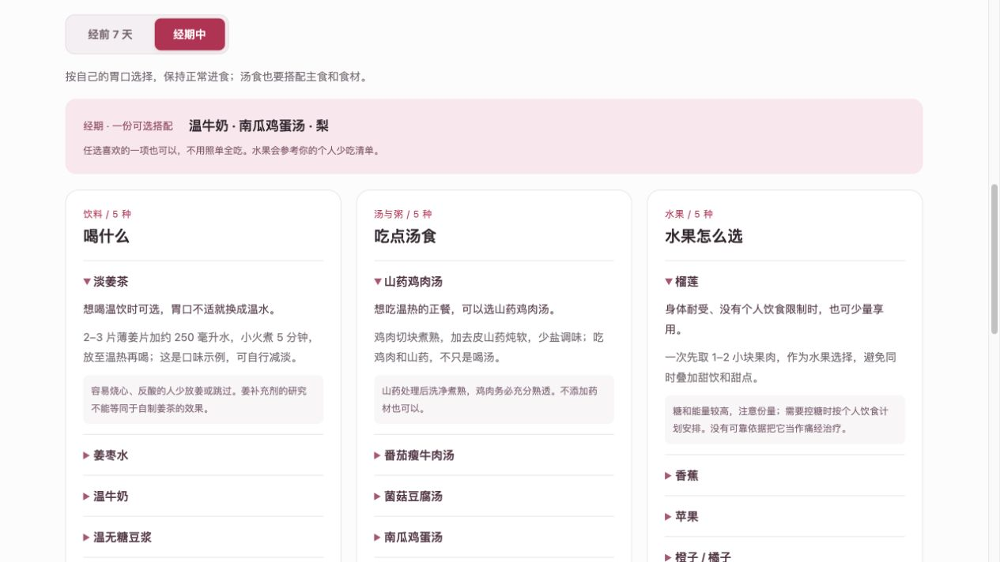

# 暖期 · Warm Days

一个中文经期关照小工具：记录周期，在经前 7 天和经期中查看饮食建议，并将提醒导入手机日历。



## 如何使用

在线版发布后，可从本仓库右侧 **About → Website** 打开。无需账号，也无需安装。

1. 填写最近一次经期第一天、平均周期、通常持续天数和提醒时间，然后保存。
2. 切换“经前 7 天 / 经期中”，查看饮料、汤食、水果共 15 种建议。点击名称展开做法和注意事项。
3. 根据个人感受填写想少吃的水果，推荐搭配会参考这份清单。
4. 点击“导出日历提醒”，将 `.ics` 文件导入手机或电脑日历，确认事件提醒与日历通知已开启。

日历文件包含未来 3 个预计周期的经前 7 天提醒。勾选“同时加入预计经期中的饮食提醒”后，也会包含预测经期的每日建议；正在经期中时会补充本次剩余天数。已经过去的提醒时间不会导出。每日提醒均采用**北京时间（UTC+8）**。

实际来经后更新日期。周期、持续天数或时间改变后，删除日历中的旧提醒，再重新导入，以免重复。

## 本地运行

下载仓库 ZIP 并解压，或者克隆仓库。安装 Node.js 20 或更新版本后，在项目文件夹运行：

```sh
npm start
```

打开终端显示的 `http://127.0.0.1:5173`。本项目没有第三方运行依赖，不需要执行 `npm install`。

也可以直接打开 `dist/index.html` 查看工具。浏览器对本地文件的存储规则可能不同，建议使用本地服务器。

## 数据与提醒

- 经期和饮食设置只保存于当前浏览器的 `localStorage`，不上传到项目服务器；不同设备和浏览器不会同步。
- 清除浏览器网站数据，或点击“清除本机记录”，会删除本机设置。已导入日历的提醒要在日历中单独删除。
- 网页关闭后不会自行推送通知。持续提醒由导入后的日历应用承担，不同应用可能忽略 `.ics` 中的提醒，需要自行检查。
- 导出的日历文件包含经期预测和饮食偏好；导入共享日历前，请确认该日历的可见范围。
- 新的 GitHub Pages 地址和旧的网站地址属于不同来源，浏览器设置不会自动迁移，需要在新地址重新填写。

## 饮食建议的边界

姜茶、姜枣水、牛奶、豆浆、家常汤粥和水果是普通饮食选择。汤食搭配主食与食材，不只喝汤；水果按个人耐受选择，榴莲注意份量，不必为经期刻意多吃。

“凉性”属于传统饮食分类，并非统一的医学禁忌。避开冰饮、吃榴莲或喝汤都不保证缓解痛经。姜相关研究主要涉及补充剂，不能等同于自制姜茶的效果。红枣水和红糖水不能替代贫血治疗。疼痛明显、加重、影响日常生活或出现异常出血时，请就医。

参考资料：

- [NHS：痛经照护](https://www.nhs.uk/symptoms/period-pain/)
- [NCCIH：姜的研究与安全性](https://www.nccih.nih.gov/health/ginger)
- [HealthHub：水果与榴莲份量](https://www.healthhub.sg/well-being-and-lifestyle/food-diet-and-nutrition/fun-fruity-facts)
- [HealthHub：均衡饮食](https://www.healthhub.sg/well-being-and-lifestyle/food-diet-and-nutrition/you-are-what-you-eat)

## GitHub Pages 发布

本仓库已经包含自动发布配置 `.github/workflows/pages.yml`。

1. 上传到公开 GitHub 仓库，默认分支设为 `main`。
2. 在 **Settings → Pages → Build and deployment → Source** 中选择 **GitHub Actions**。
3. 在 **Actions → Publish Warm Days → Run workflow** 执行首次发布。
4. 成功后，将 Pages 提供的地址填写到仓库 **About → Website**，别人就能直接打开使用。

以后对 `main` 分支的更新会自动发布。GitHub Pages 只发布 `dist/` 中的网页文件。

官方说明：[使用 GitHub Actions 发布 Pages](https://docs.github.com/en/pages/getting-started-with-github-pages/using-custom-workflows-with-github-pages)。

## 文件结构

```text
dist/index.html       页面结构
dist/style.css        桌面和手机样式
dist/app.js           页面交互、本机保存
dist/logic.js         周期计算、日历导出
dist/suggestions.js   饮食建议与搭配
scripts/serve.cjs     无第三方依赖的本地服务器
test/calendar.cjs    日期与日历导出的回归检查
```

修改后运行 `npm test` 检查关键日期与提醒逻辑。
